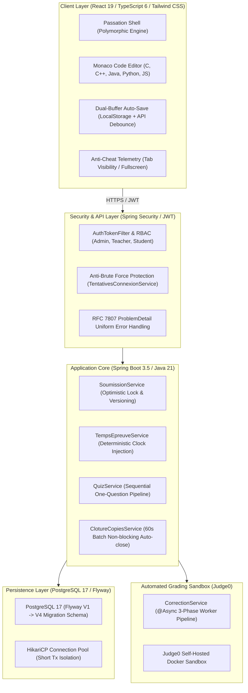

# 🎓 EvalPlatform — Open-Source University Assessment & Automated Grading Engine

[](LICENSE)
[](https://openjdk.org/projects/jdk/21/)
[](https://spring.io/projects/spring-boot)
[](https://react.dev/)
[](https://www.typescriptlang.org/)
[](https://www.postgresql.org/)
[](https://testcontainers.com/)
[](https://judge0.com/)

**EvalPlatform** is an open-source digital assessment, automated code-grading, and academic integrity platform currently under active development at **École Polytechnique de Thiès (EPT, Senegal)** as a transversal engineering project (DIC1-GIT).

It is designed to address the high licensing costs, lack of infrastructure resilience (network packet loss, campus NAT bottlenecks), and fragmented workflows of existing tools by offering a sovereign, reliable, and self-hosted examination system for computer science education.

---

## 🏛️ System Architecture



---

## ✨ Key Capabilities

### 1. 📝 Polymorphic Student Passation Engine
- **Unified Assessment Interface**: Single polymorphic screen ([`PassationEpreuve.tsx`](eval-platform-frontend/src/pages/etudiant/passation/PassationEpreuve.tsx)) supporting Multiple Choice Questions (single/multi-select), open conceptual essay questions, and live programming exercises.
- **Embedded IDE Experience**: Built-in Monaco code editor supporting syntax highlighting, auto-indentation, and multi-language execution in C, C++, Java, Python, and JavaScript.
- **Sequential Timed Quizzes**: Dedicated question-by-question quiz engine ([`QuizService.java`](eval-platform-backend/src/main/java/sn/ept/eval/service/QuizService.java)) where future questions remain completely sealed from the client until unlocked.

### 2. ⚡ Automated Code Grading Sandbox (Judge0 Integration)
- **3-Phase Worker Model**:
  1. *Short-Transaction Locking*: Claims pending copies under optimistic/pessimistic locks.
  2. *Off-Transaction Asynchronous Execution*: Dispatches code and test suites (visible + hidden) to Judge0 without tying up database connection pools.
  3. *Resilient Score Recording*: Records results with exponential backoff and automatic retry logic.
- **Safety First**: Full execution isolation with memory limits, execution time thresholds, and compile-time sandboxing.

### 3. 🛡️ Academic Integrity & Anti-Cheat
- **Zero Leakage**: Student DTOs strictly filter out `estCorrect` indicators, teacher rubrics, and hidden validation test cases until official publication.
- **Strict Anti-IDOR**: Identities are extracted cryptographically from verified JWT tokens; students can only access their designated promotion and their own copies.
- **Telemetry Monitoring**: Client-side tab switches and focus losses are tracked and persisted in real time to generate teacher supervision alerts.
- **Brute-Force & Spraying Defense**: Two-tier memory-bounded rate limiting tracking `(email, IP)` pairs and collective campus NAT addresses.

### 4. ⏱️ Deterministic Temporal Integrity & Resilience
- **Injected `java.time.Clock`**: Complete elimination of hardcoded system clocks to ensure 100% deterministic time calculations and reproducible automated tests.
- **Batch Auto-Close Job**: Background scheduler running every 60s to close expired submissions with zero N+1 database queries and automated accommodation (tiers-temps) calculation.
- **Network-Fault Tolerance**: Dual-buffer auto-save guarantees that local draft changes survive browser crashes or Wi-Fi packet drops.

### 5. 🤖 AI-Assisted Open Question Evaluation
- Built-in data architecture (`PropositionIA`) designed for LLM-assisted grading of essay answers, suggesting rubric-aligned grades and constructive justifications for teacher validation.

---

## 🛠️ Technology Stack

| Layer | Technologies |
| :--- | :--- |
| **Backend** | Java 21, Spring Boot 3.5, Spring Data JPA, Hibernate 6, Spring Security 6 (JWT), Flyway, Jackson |
| **Frontend** | React 19, TypeScript 6, Vite 8, Tailwind CSS v4, TanStack Query v5, Monaco Editor, Lucide Icons |
| **Database** | PostgreSQL 17, HikariCP, JPA Auditing |
| **Testing** | JUnit 5, Mockito, AssertJ, Testcontainers (PostgreSQL 17), StatementInspector (N+1 Traps), Vitest |
| **Sandbox** | Judge0 API (Docker containerized execution) |

---

## 🚀 Quick Start

### Prerequisites
- **JDK 21** or later
- **Maven 3.9+**
- **Node.js 20+** and **npm** / **pnpm**
- **Docker** (optional, for PostgreSQL and Judge0 local sandbox)

### 1. Clone the repository
```bash
git clone https://github.com/MorLeye75/eval-platform.git
cd eval-platform
```

### 2. Run Backend (`eval-platform-backend`)

#### Option A: In-Memory Development (H2 Dev Profile)
Zero external database required:
```bash
cd eval-platform-backend
mvn spring-boot:run -Dspring-boot.run.profiles=h2-dev
```
- API Base URL: `http://localhost:8080/api`
- Swagger UI Documentation: `http://localhost:8080/api/swagger-ui/index.html`
- H2 Console: `http://localhost:8080/api/h2-console`

#### Option B: Local PostgreSQL (Dev Profile)
```bash
# Create local database
createdb eval_platform_db

# Run Spring Boot (Flyway automatically applies V1..V4 migrations)
mvn spring-boot:run
```

### 3. Run Frontend (`eval-platform-frontend`)
```bash
cd ../eval-platform-frontend
npm install
npm run dev
```
Open `http://localhost:5173` in your browser.

---

## 🧪 Automated Test Suite

EvalPlatform is engineered with a strict quality-first philosophy:

```bash
# Run backend integration tests with Testcontainers (real PostgreSQL 17)
cd eval-platform-backend
mvn clean test

# Run frontend unit & component tests
cd ../eval-platform-frontend
npm run test
```

- **25+ Backend Integration Test Suites**: Covering concurrency, pessimistic locks, token lifecycles, and N+1 query regression traps.
- **10+ Frontend Vitest Suites**: Testing passation hooks (`usePassation`, `useAutoSave`), timer synchronization, and anti-cheat hooks.

---

## 👥 Demo Credentials (Local Dev Only)

| Role | Email | Password | Access Scope |
| :--- | :--- | :--- | :--- |
| **Administrateur** | `admin@ept.sn` | `admin123` | System oversight & promotion management |
| **Enseignant** | `prof@ept.sn` | `prof123` | Exam builder, AI grading & supervision |
| **Étudiant (DIC2)** | `etudiant@ept.sn` | `etudiant123` | Polymorphic exam taking & live coding |

---

## 📄 License & Attribution

This project is licensed under the **MIT License** — see the [LICENSE](LICENSE) file for details.

Developed with pride by **Mor Leye & contributors** as part of the engineering curriculum at **École Polytechnique de Thiès (EPT)**.

