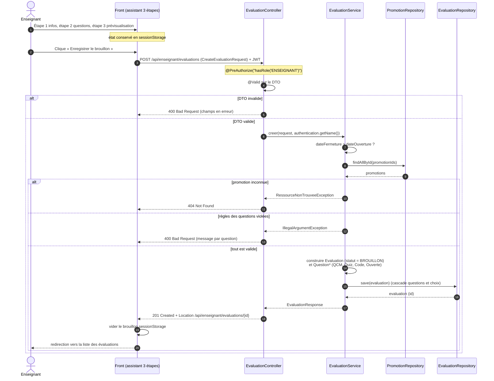
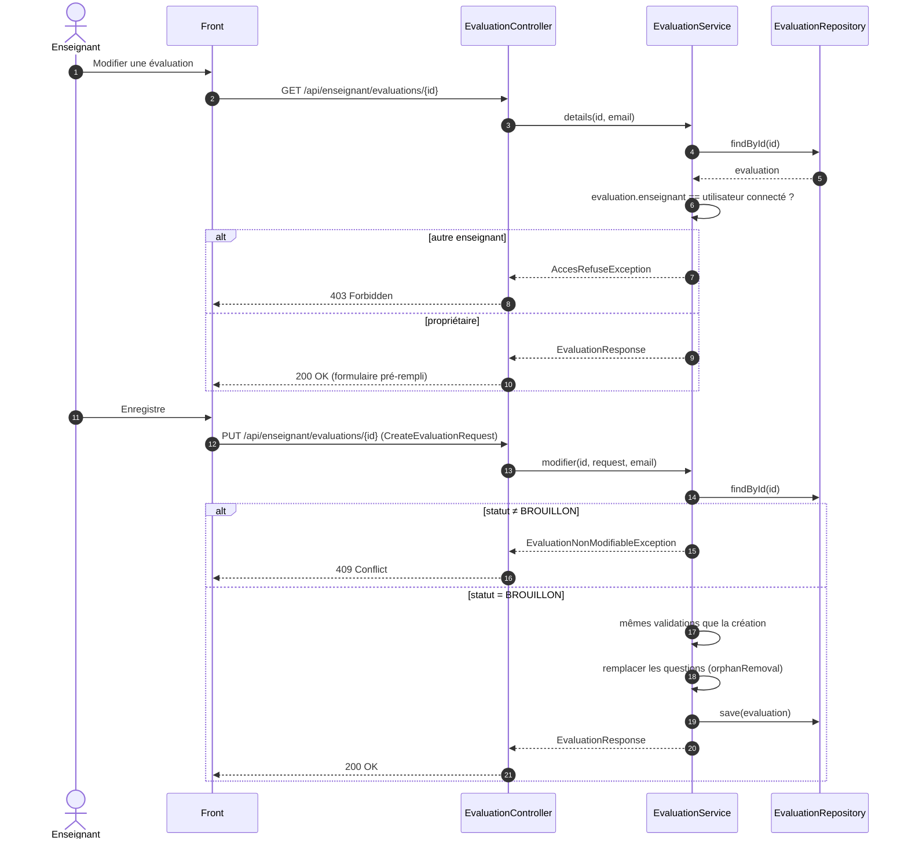
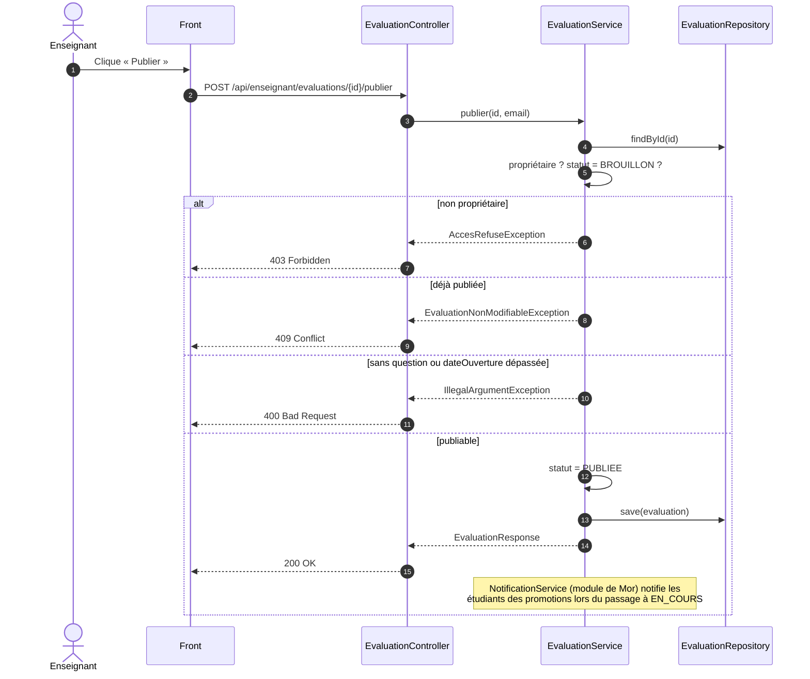
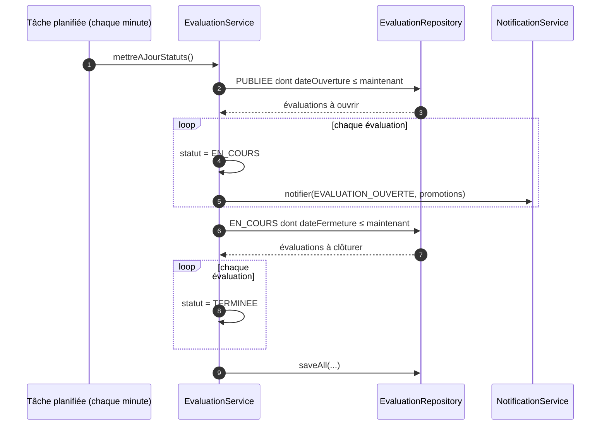
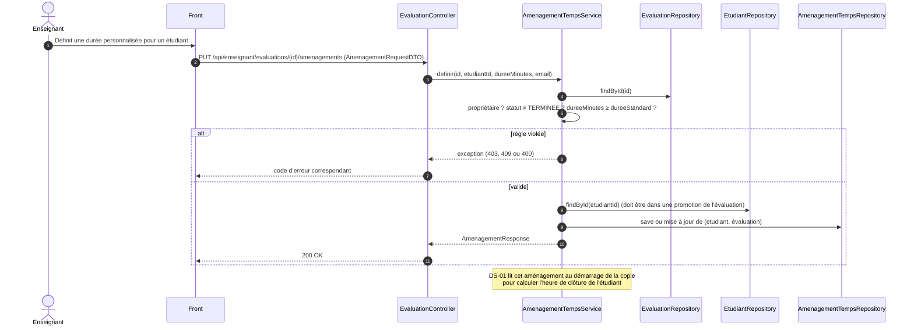

# DS-03 — Création, édition et publication d'une évaluation (Enseignant)

> Auteur : Aminou NIANG — statut : **à valider par Mor avant codage**.
> Classes concernées : `EvaluationController`, `EvaluationService`, `AmenagementTempsService`, `EvaluationRepository`, `PromotionRepository`, `QuestionRepository`, `AmenagementTempsRepository`.
> Les diagrammes DS-01 (soumission) et DS-02 (auto-save) sont ceux de Mor.

## Décisions de conception (à confirmer)

| # | Décision | Pourquoi |
|---|---|---|
| 1 | L'assistant 3 étapes garde son état **côté front** (brouillon `sessionStorage`, déjà en place). Un seul `POST` crée l'évaluation avec ses questions. | Évite des brouillons à moitié remplis en base et un endpoint par étape. |
| 2 | Toute évaluation créée est en `BROUILLON`. `PUBLIEE` se déclenche uniquement par `POST /{id}/publier`. | Cycle de vie du CDC : BROUILLON → PUBLIEE → EN_COURS → TERMINEE. |
| 3 | Modification et suppression possibles **uniquement en `BROUILLON`**. Sinon `409 Conflict`. | Une copie peut exister dès la publication : on ne change plus les questions. |
| 4 | `PUBLIEE → EN_COURS → TERMINEE` est fait par une tâche planifiée (pas par l'enseignant). | `SoumissionService` teste déjà `dateOuverture` / `dateFermeture` ; le statut doit rester cohérent avec elles. |
| 5 | Le propriétaire est lu dans le JWT (`Authentication`), jamais dans le corps de la requête. Un enseignant ne touche que ses évaluations (`403` sinon). | Sécurité : aucun `enseignantId` fourni par le client. |
| 6 | La validation métier des questions est dans `EvaluationService`, par type (voir tableau ci-dessous). Les contraintes simples (`@NotBlank`, `@Min`) sont dans les DTO. | Un seul endroit à tester. |

Règles de validation par type de question :

| Type | Règles |
|---|---|
| `QCM` | ≥ 2 choix ; ≥ 1 choix correct ; si `estChoixMultiple = false`, exactement 1 choix correct |
| `QUIZ_CHRONOMETREE` | règles du QCM + `dureeQuestion` > 0 |
| `CODE` | ≥ 1 cas de test ; chaque cas a `entree` et `sortieAttendue` |
| `OUVERTE` | `enonce` non vide, rien d'autre |
| toutes | `points` > 0 ; `ordre` unique dans l'évaluation |

## 1. Création (brouillon)

## 2. Modification d'un brouillon

## 3. Publication

## 4. Passage automatique `PUBLIEE → EN_COURS → TERMINEE`

Le passage `TERMINEE` ne clôt pas les copies encore `EN_COURS` : c'est le rôle de DS-01 (soumission automatique à l'expiration).

## 5. Aménagement de temps (tiers-temps)

## Endpoints résultant des diagrammes

| Méthode | Route | Rôle | Succès | Erreurs |
|---|---|---|---|---|
| `POST` | `/api/enseignant/evaluations` | créer un brouillon | 201 | 400, 404 |
| `GET` | `/api/enseignant/evaluations` | mes évaluations | 200 | |
| `GET` | `/api/enseignant/evaluations/{id}` | détail | 200 | 403, 404 |
| `PUT` | `/api/enseignant/evaluations/{id}` | modifier un brouillon | 200 | 400, 403, 404, 409 |
| `DELETE` | `/api/enseignant/evaluations/{id}` | supprimer un brouillon | 204 | 403, 404, 409 |
| `POST` | `/api/enseignant/evaluations/{id}/publier` | BROUILLON → PUBLIEE | 200 | 400, 403, 404, 409 |
| `PUT` | `/api/enseignant/evaluations/{id}/amenagements` | tiers-temps | 200 | 400, 403, 404, 409 |

## Nouvelles classes à créer (selon ces diagrammes)

- DTO : `CreateEvaluationRequest`, `QuestionRequestDTO`, `ChoixDTO`, `CasDeTestDTO`, `AmenagementRequestDTO`, `EvaluationResponse`.
- Exception : `EvaluationNonModifiableException` (→ 409 dans `GlobalExceptionHandler`, fichier de Mor).
- Tâche planifiée : `@EnableScheduling` à ajouter (config de Mor : à valider avec lui).

## Questions pour Mor

1. Routes : on garde `/api/enseignant/evaluations` (comme dans ton message) alors que `SoumissionController` utilise `/soumissions` ?
2. OK pour ajouter `EvaluationNonModifiableException` dans `GlobalExceptionHandler` et `@EnableScheduling` ?
3. La notification `EVALUATION_OUVERTE` : tu exposes une méthode `NotificationService.notifier(type, promotions)` ou on se met d'accord sur la signature ?
